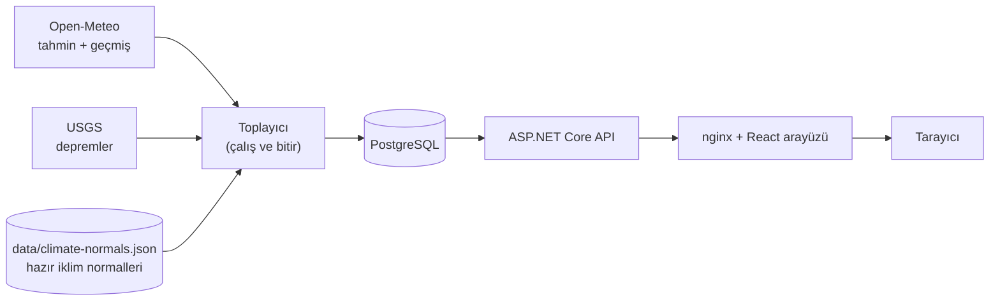

# Türkiye Hava Durumu ve Deprem Paneli


Türkiye'nin 81 ili ve KKTC için **"bugün normalden ne kadar sıcak ya da soğuk?"** sorusunu tek bakışta yanıtlayan, ücretsiz açık veriyle çalışan bir harita paneli. Her bölgenin rengi, bugünkü sıcaklığın **1991-2020 iklim normalinden sapmasını** gösterir. İsteğe bağlı deprem katmanı, son depremleri büyüklüğe göre daire olarak çizer.

> Portföy projesidir, ticari değildir. Veri kaynaklarının kullanım şartları aşağıda.

## Ne yapar

- **Anomali haritası:** 81 il + KKTC, normalden sapmaya göre renkli. Üzerine gelince il yükselir, tıklayınca sağ panelde 7 günlük tahmin ve sapma açılır.
- **Deprem katmanı:** Büyüklüğe göre boyutlanan daireler; "son 1/7/30 gün" ve "en az büyüklük" süzgeçleri. Daireye gelince kart (saat, il, en yakın yerleşim, derinlik). İç içe giren depremler tek bir **küme işaretinde** toplanır, tıklayınca etrafa yayılır ve her biri gerçek konumuna çizgiyle bağlanır.
- **Hesaplanmış iklim normalleri repoda:** 30 yıllık veriyi her kurulumda çekmek yerine `data/climate-normals.json` yüklenir (neden: aşağıda "Karşılaşılan gerçek sorunlar").

## Hızlı başlangıç (Docker)

Gereken tek şey **Docker Desktop**. .NET, Node ya da PostgreSQL kurmanıza gerek yok.

1. Proje klasöründe `.env` dosyası oluşturun (`.env.example`'ı kopyalayabilirsiniz). Şu değişkenler gerekir; `.env` git'e girmez:

   ```
   POSTGRES_PASSWORD=kendi-parolaniz      # zorunlu; ';' karakteri kullanmayın
   POSTGRES_USER=hava_user                # isteğe bağlı
   POSTGRES_DB=hava_paneli                # isteğe bağlı
   ```

2. Tek komut (ilk seferde imajları indirip derler: bu makinede yaklaşık 2 dakika 12 saniye; imajlar hazırken yaklaşık 40 saniye):

   ```bash
   docker compose up -d --build
   ```

3. Tarayıcıda **http://localhost:8080** adresini açın.

Bu komut sırayla: veritabanını başlatır → `init` servisi şemayı kurar, hazır iklim normallerini yükler ve ilk tahmin/deprem verisini çeker → API'yi ve arayüzü açar. Veri toplama başarısız olursa (internet yoksa) uygulama yine açılır; sonra yenilemek için:

```bash
docker compose run --rm collector            # tahmin + depremleri yenile
```

Portlar çakışırsa `.env`'ye `WEB_PORT=8081` ya da `DB_PORT=5433` ekleyin. Durdurmak için `docker compose down` (veri kalır), veriyi de silmek için `docker compose down -v`.

## Nasıl çalışıyor



- **Toplayıcı** ayrı bir "çalış ve bitir" programıdır; zamanlanmış bir işle (ör. GitHub Actions) çağrılır. API uyusa bile veri akar (ücretsiz barındırmada API boştayken uyur).
- **API** yalnızca okur; şemayı toplayıcı yönetir.
- **nginx** statik arayüzü sunar ve `/api` isteklerini API'ye iletir: tarayıcı tek adrese konuşur, CORS gerekmez.

Katmanlı .NET 8 çözümü (içe doğru bağımlılık): `Domain` → `Application` → `Infrastructure` → `Api` / `Collector`. Kararlar ve **reddedilen alternatifler** [docs/ARCHITECTURE.md](docs/ARCHITECTURE.md)'de, olası mülakat soruları ve cevapları [docs/INTERVIEW.md](docs/INTERVIEW.md)'de, yapılacaklar [docs/ROADMAP.md](docs/ROADMAP.md)'de.

## Veri kaynakları ve lisanslar

| Kaynak | Ne için | Lisans / şart |
|---|---|---|
| [Open-Meteo](https://open-meteo.com/) | Tahmin ve 1991-2020 geçmiş veri (ERA5-Land) | CC BY 4.0, **ticari olmayan** kullanım için ücretsiz; atıf zorunlu (arayüzde gösterilir) |
| [USGS](https://earthquake.usgs.gov/) | Depremler | Kamu verisi; küçük depremler Türkiye için eksik olabilir |
| [Natural Earth](https://www.naturalearthdata.com/) | İl sınırları | Kamu malı |

MGM ve Kandilli kullanılmadı (resmi, belgeli açık API'leri yok; siteyi kazımak kırılgan olurdu). AFAD'ın kullanım şartı doğrulanamadığı için kullanılmadı.

## API

| Uç | Açıklama |
|---|---|
| `GET /health` | Sağlık ucu |
| `GET /api/cities` | 81 il + 6 KKTC ilçesi |
| `GET /api/cities/{id}/forecast` | 7 günlük tahmin, her gün için iklim normali ve anomali (`id`: `istanbul`, `sanliurfa` gibi ASCII kimlik) |
| `GET /api/map` | Haritadaki 87 noktanın bugünkü özeti |
| `GET /api/earthquakes?days=7&minMagnitude=2.5` | Son depremler (1-30 gün, büyüklük 0-10) |
| `GET /api/sources` | Veri kaynakları ve lisansları (atıf için) |

Hatalar standart `ProblemDetails` JSON'udur (bilinmeyen şehir 404, geçersiz parametre 400).

## Ölçümler

Docker Compose yığınına karşı, nginx üzerinden, tek makinede (Windows 11, Docker Desktop). Her uçta 300 art arda istek (+30 ısınma), sonra 20 paralel bağlantıyla 600 istek. **Hata: 0.** Sonuçlar bu makineye bağlıdır; mutlak değil, göreli bir fikir verir. Eş zamanlı ölçüm kısadır (her uç için bir saniyenin altında), yük testi değil. Betik: [`scripts/measure-api.mjs`](scripts/measure-api.mjs).

| Uç | p50 | p95 | Eş zamanlı p95 | İstek/sn (eş zamanlı) |
|---|---:|---:|---:|---:|
| `/api/cities` (statik liste) | 1,2 ms | 1,4 ms | 9,5 ms | 3380 |
| `/api/cities/ankara/forecast` | 2,5 ms | 3,2 ms | 13,4 ms | 2787 |
| `/api/earthquakes?days=30` | 1,4 ms | 1,7 ms | 10,6 ms | 3312 |
| `/api/map` (87 nokta + normaller) | 8,6 ms | 14,1 ms | 27,6 ms | 1159 |

`/api/map` en yavaş uçtur: her istekte 87 şehrin 366 günlük normalini veritabanından okur. Normal değişmediği için bellekte önbelleğe alınabilir (yol haritasında).

Diğer ölçümler: ilk kurulum (`docker compose up -d --build`, imajlar zaten indirilmişken) yaklaşık 40 saniye; 87 şehrin tahmini + 30 günün depremleri toplayıcı ile yaklaşık 45 saniye. İmaj boyutları: API 330 MB, toplayıcı 295 MB, arayüz 94 MB. API root olmayan kullanıcıyla çalışır.

## Testler

- **.NET: 163 test** (Domain 39, Application 37, Infrastructure 66, Api 21). Altyapı ve API testleri **gerçek PostgreSQL'i** Testcontainers ile açar (sahte veritabanı upsert, tarih tipleri ve migration hatalarını gizler). Dış API'ler sahte HTTP işleyicisiyle taklit edilir, testler internete bağlı kalmaz.
- **Arayüz: 74 test** (Vitest): renk kovaları, Türkçe sayı biçimi, deprem kümeleme ve yayılma yerleşimi, kart yerleşimi.
- **CI** (GitHub Actions): her push ve PR'da .NET (SDK 8 ile derleme + testler), arayüz (lint, tür denetimi, testler, derleme) ve Docker imajlarının derlenebilirliği.

```bash
dotnet test                       # .NET testleri (Docker çalışıyor olmalı)
cd web && npm ci && npm test      # arayüz testleri
```

## Geliştirme modu (Docker olmadan API ve arayüz)

Veritabanını Docker'da açın (`docker compose up -d db`), bağlantı dizesini ortam değişkeniyle verin (parola repoda durmaz):

```powershell
$env:ConnectionStrings__Default = "Host=localhost;Port=5432;Database=hava_paneli;Username=hava_user;Password=PAROLANIZ"
dotnet run --project src/HavaPaneli.Collector -c Release -- --import-normals data/climate-normals.json
dotnet run --project src/HavaPaneli.Collector -c Release     # tahmin + depremler
dotnet run --project src/HavaPaneli.Api                      # http://localhost:5099
```

Başka bir terminalde `cd web && npm install && npm run dev` (Vite, `/api` isteklerini 5099'a iletir).

## Karşılaşılan gerçek sorunlar

Bu projede sahte (mock) testlerle görülemeyen, gerçek çalıştırmada çıkan sorunlar ve çözümleri; ayrıntısı [ARCHITECTURE.md](docs/ARCHITECTURE.md)'de:

- **Open-Meteo limiti istek sayısına değil ağırlığına bakar.** 87 şehrin 30 yıllık verisi dakikalık, sonra saatlik limite takıldı. Çözüm: dakikalık limitte bekleyip yeniden deneyen HTTP işleyicisi, ve hesaplanmış normalleri repoda tutmak (her kurulumda API'ye gitmemek için).
- **Sınır verisindeki il adları güvenilmezdi** (`Kinkkale`, `Zinguldak`, Türkçe karakter yok). Adlara güvenmek yerine, kendi şehir koordinatlarımın hangi çokgenin içine düştüğüne bakarak eşledim (81/81).
- **Telefon genişliğinde hover kartı kabın dışına taşıyordu.** Kart sığmıyorsa gösterilmiyor; dokununca yan panel açılıyor.
- **Docker'da `/health` yanlış "sağlıklı" dönüyordu:** nginx bilinmeyen yolu `index.html`'e düşürüyordu. Artık gerçek API'ye iletiliyor.

## Bilinen sınırlar

- **İlçe yok.** Kaynağım yalnızca il sınırı veriyor; KKTC haritada tek bölge, ilçeleri yan panelde listelenir. Deprem kartında "ilçe" yerine USGS'nin "en yakın yerleşim" bilgisi gösterilir.
- **USGS Türkiye'de küçük depremleri eksik verir**; resmi kayıt için AFAD ve Kandilli'ye bakın.
- **Canlı demo henüz yok** (kartsız yol planlandı: Neon + Render + Cloudflare Pages).
- Harita telefonda küçük kalır; telefon düzeni iyileştirilecek. Ekran görüntüsü/GIF henüz eklenmedi.
- Open-Meteo verisi ticari olmayan kullanım içindir; ticari kullanım için ayrı plan gerekir.
